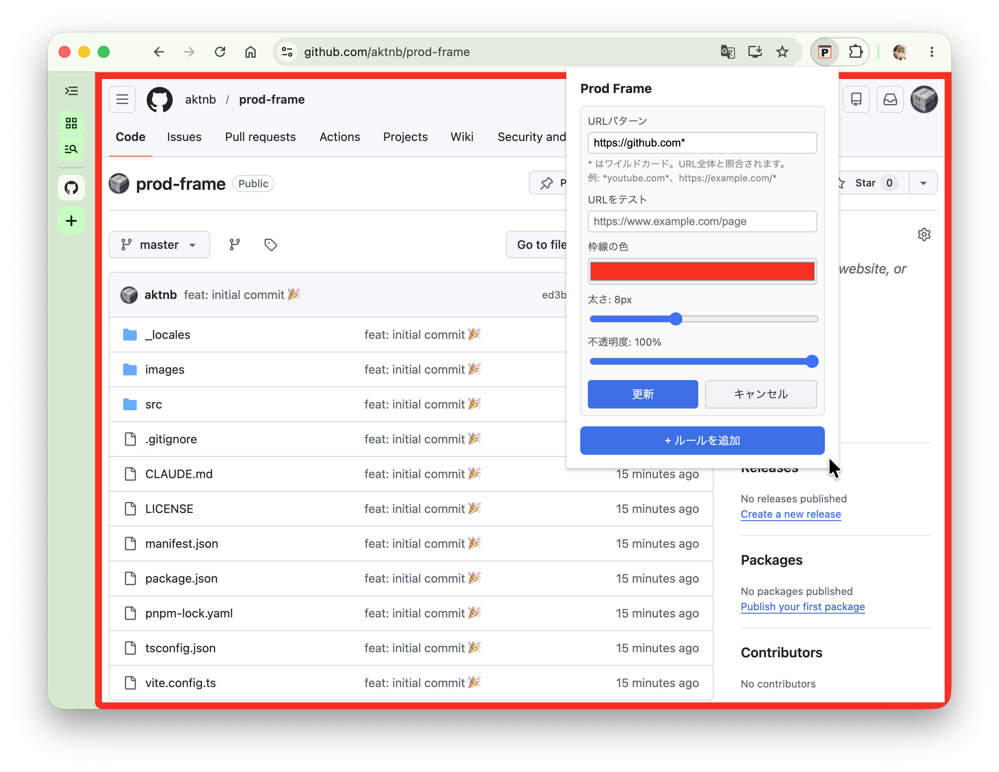

# Prod Frame

URLパターンにマッチしたWebページに枠線を表示するChrome拡張機能。本番環境と検証環境の取り違えを防ぐ。

## スクリーンショット



## 機能

- URLパターン（グロブ形式）を登録し、マッチしたページに枠線を表示
- 枠線の色・太さ・不透明度を自由に設定
- ルールごとの有効/無効切り替え
- SPA対応（`popstate` + `MutationObserver` でURLの変化を検知）
- ルール変更をリアルタイム反映（ページリロード不要）

## 開発

```bash
pnpm dev        # ウォッチモードでビルド（ファイル変更を自動検知）
pnpm build      # プロダクションビルド → dist/
pnpm typecheck  # 型チェック（noEmit）
```

`pnpm dev` 実行中は、ソースを変更するとすぐに `dist/` が更新される。Chrome の拡張機能管理画面で「更新」ボタンを押すと最新のビルドが反映される。

## リリース

1. `package.json` の `version` を新しいバージョンに更新し、変更を `master` にマージする。
2. 最新の `master` で、同じバージョンの新規タグを作成して push する（例: `version` が `1.0.2` の場合）。

   ```bash
   git switch master
   git pull --ff-only origin master
   git tag v1.0.2
   git push origin v1.0.2
   ```

`v*` タグの push で Release workflow が実行され、型チェック・本番ビルド・ZIP 検証に成功すると GitHub Release に `prod-frame-v1.0.2.zip` が添付される。タグと `package.json`・ビルド済み manifest のバージョンが一致しない場合は公開を中止する。

### 配布 ZIP のインストール

1. [GitHub Releases](https://github.com/aktnb/prod-frame/releases) から `prod-frame-vX.Y.Z.zip` をダウンロードして解凍する。
2. Chrome で `chrome://extensions/` を開き、デベロッパーモードを有効にする。
3. 「パッケージ化されていない拡張機能を読み込む」から、`manifest.json` がある解凍先フォルダを選択する。

## 使い方

1. ツールバーの Prod Frame アイコンをクリックしてポップアップを開く
2. URLパターン（例: `https://example.com/*`）と枠線スタイルを設定してルールを追加
3. マッチするページを開くと枠線が表示される

### URLパターン

グロブ形式で指定する。`*` は任意の文字列にマッチする。

| パターン | マッチ例 |
|---|---|
| `https://example.com/*` | `https://example.com/any/path` |
| `https://*.example.com/*` | `https://staging.example.com/` |
| `https://example.com/admin*` | `https://example.com/admin/users` |

## 技術スタック

- TypeScript (strict mode)
- React 18
- Vite + @crxjs/vite-plugin
- Chrome Extension Manifest V3

## ライセンス

[LICENSE](LICENSE) を参照。
